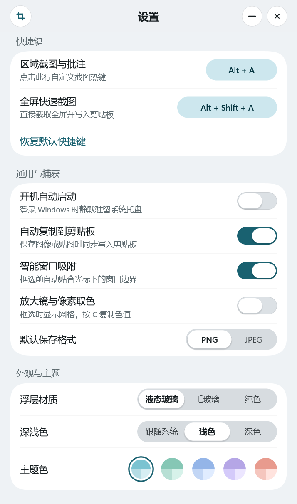
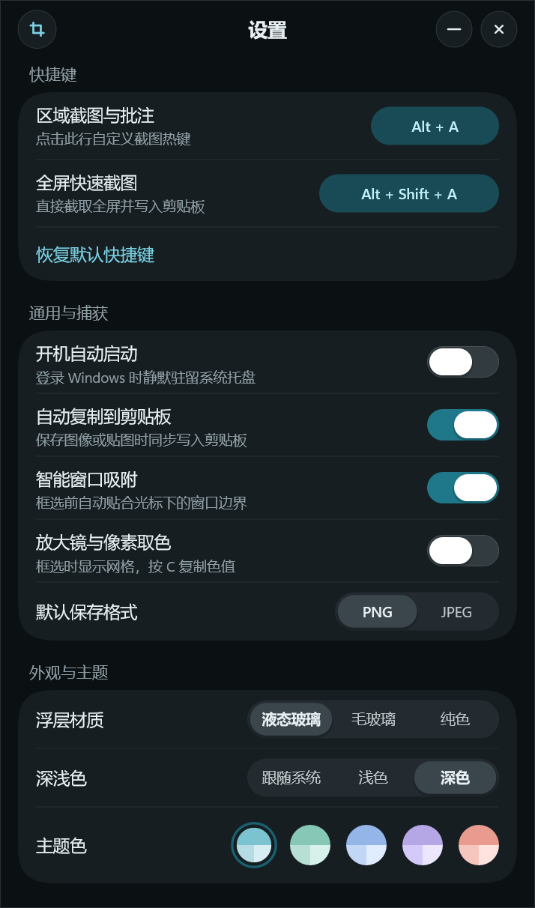

<h1 align="center">🍡 MochiShot</h1>

<p align="center">
  <strong>超轻量级原生 Windows 液态玻璃截图与批注工具</strong><br>
  设计语言、G2 连续曲率圆角、弹簧果冻动效与液态玻璃着色器配方致敬 <a href="https://github.com/feice11/mochi-compose">feice11/mochi-compose</a>
</p>

<p align="center">
  <a href="https://github.com/ackd7/MochiShot/actions/workflows/ci-release.yml"></a>
  <a href="https://github.com/ackd7/MochiShot/releases/latest"></a>
  
  
  <a href="LICENSE"></a>
</p>

<p align="center">
  
  &nbsp;&nbsp;
  
</p>

---

## ✨ 特性亮点

- **极致轻量与超低内存**：
  - 纯原生 **C++20 + Win32 + Direct3D 11 + Direct2D 1.1 + DirectWrite + WIC** 构建，静态编译单文件 `.exe` 仅约 **400 KB**，无需安装任何运行库（零 VC++ Redist / 零 WebView2 / 零 JVM 依赖）。
  - 采用**按需懒加载与空闲挂起 GPU 架构**：后台托盘常驻时自动释放 D3D11/D2D 驱动缓冲并整理工作集，物理内存（Working Set）仅 **~1.5 – 4 MB**；唤醒截图时复用预缓存的 HLSL 字节码，毫秒级瞬时响应。
- **Mochi Compose 美学与 HLSL 液态玻璃（Liquid Glass）**：
  - **G2 连续曲率圆角（`MochiRoundedRectangle` / `MochiCapsule`）**：告别生硬的圆弧切线接缝，全局卡片（`26dp`）、胶囊开关、工具栏均采用超椭圆 G2 连续轮廓与同心内缩（`MochiConcentric`）几何对齐。
  - **实时 HLSL 像素着色器液态玻璃**：截图浮动工具栏、属性栏、放大镜及设置页底栏均支持实时背景折射（内/外斜角透镜偏移 + 微光学色散）、硬件多级 Mip 磨砂模糊、Mochi 面色矩阵提拉与 Fresnel 镜面边缘高光，同时提供 **液态玻璃 / 毛玻璃 / 纯色** 三档材质切换。
  - **240Hz 子步长物理弹簧动效**：包含 iOS 26 风格 `60×28` 宽胶囊开关果冻拉伸（`JellyStretch`）、分段控制器滑块追随、橡皮筋越界回弹（`RubberBand`）、按压缩放与指尖径向柔光（`PressGlow`），以及 `420ms` 主题色板平滑插值（青玉 / 竹青 / 海蓝 / 鸢尾 / 珊瑚）。
- **顺手的捕获与丰富批注编辑**：
  - **多显示器 Per-Monitor DPI v2 原生像素级捕获** + **DWM 智能窗口边界自动吸附**（自动过滤挂起/隐藏的 UWP 幽灵窗口）。
  - **11×11 实时像素放大镜与取色器**：实时展示选区尺寸、坐标与 `#RRGGBB` 色值，框选前按 `C` 一键复制 HEX 颜色。
  - **9 种批注工具**：
    1. **移动/八向缩放选区**
    2. **自由画笔**（二次贝塞尔中点平滑曲线）
    3. **荧光笔**（单笔独立离屏透明度合成，交叉涂抹不叠黑）
    4. **G2 连续圆角矩形框**
    5. **椭圆框**
    6. **流线几何渐变箭头**
    7. **自动递增序号标（`1` `2` `3`...）**
    8. **文字批注**（支持中文输入法 IME 跟随、多行输入、`Ctrl+V` 粘贴）
    9. **网格对齐马赛克 / 高斯模糊遮挡**（自由涂抹不糊格，按住 `Shift` 可直接框选矩形打码区域）
  - **桌面悬浮贴图（`T`）**：一键将截图及批注固定在屏幕最顶层，支持滚轮无级缩放（`20%–400%`）、`Ctrl + 滚轮` 调节透明度、右键复制或另存为。
- **自定义全局快捷键 & 无权限开机自启动**：
  - 在 Mochi 设置中心直接点击热键胶囊即可录制任意全局快捷键（自动检测热键冲突并提示）。
  - 一键切换 Windows 登录静默自启动（写入当前用户 `HKCU\...\Run` 并附带 `--silent` 参数，无需 UAC 管理员提权）。

---

## ⌨️ 默认快捷键

| 场景 | 快捷键 / 操作 | 功能说明 |
|---|---|---|
| **全局热键** | `Alt + A`（可自定义） | 启动区域截图与批注 |
| **全局热键** | `Alt + Shift + A`（可自定义） | 快速截取整个桌面并复制到剪贴板 |
| **框选阶段** | 单击鼠标左键 | 自动吸附光标下的窗口轮廓 |
| **框选阶段** | 拖拽鼠标左键 | 自由框选任意区域 |
| **框选阶段** | `C` | 复制光标处像素的 `#RRGGBB` 色值 |
| **编辑阶段** | `Enter` / `Ctrl + C` / 双击选区 | 完成批注并复制到系统剪贴板 |
| **编辑阶段** | `Ctrl + S` | 另存为无损 `PNG` 或高质量 `JPEG` |
| **编辑阶段** | `T` | 将当前选区化为悬浮贴图固定在桌面 |
| **编辑阶段** | `Ctrl + Z` / `Ctrl + Y` | 撤销 / 重做上一步批注 |
| **编辑阶段** | `Shift + 拖拽`（马赛克/模糊） | 框选矩形区域快速打码 |
| **编辑阶段** | 鼠标右键 / `Esc` | 重新框选（无批注时右键） / 退出截图 |
| **贴图窗口** | 滚轮 / `Ctrl + 滚轮` / 双击 | 缩放贴图 / 调节透明度 / 关闭贴图 |

---

## 🛠️ 本地编译

环境要求：Windows 10 / 11 SDK + Visual Studio 2022（MSVC C++20）+ CMake 3.20+。

```powershell
cmake -S . -B build -A x64
cmake --build build --config Release --parallel

# 运行内置自动化自检套件（验证弹簧物理、G2 SDF、HLSL 着色器编译与批注导出管线）
.\build\Release\MochiShot.exe --self-test
```

命令行参数：
- `MochiShot.exe`：启动托盘常驻并打开 Mochi 设置中心（单实例互斥，已运行时自动唤起设置窗口）
- `MochiShot.exe --silent`：静默启动至系统托盘（开机自启默认参数，超低内存待机）
- `MochiShot.exe --capture`：启动后立即进入区域截图

---

## 🙏 致谢

- [feice11/mochi-compose](https://github.com/feice11/mochi-compose)：UI 设计理念、Material 3 Expressive + iOS 26 交互规范、G2 连续曲率圆角几何及液态玻璃着色器配方参考。

## 📄 开源协议

本项目基于 [Apache License 2.0](LICENSE) 开源发布。
